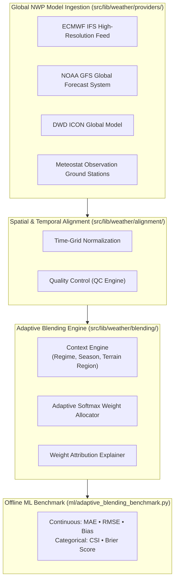

<div align="center">

# 🌦️ Harmausam
### Explainable Context-Aware Hybrid AI-NWP Weather Forecast Blending Engine

<br/>

[](https://www.typescriptlang.org/)
[](https://react.dev)
[](https://python.org)
[](https://open-meteo.com)

</div>

---

## 🌩️ 1. Scientific Overview & Problem Statement

Numerical Weather Prediction (NWP) models (such as **ECMWF IFS**, **NOAA GFS**, and **DWD ICON**) exhibit distinct regional and regime-dependent skill biases. A model that excels at predicting synoptic-scale monsoon rainfall over the Indo-Gangetic Plains may severely overpredict convective storm cells over mountainous terrain.

**Harmausam** is an **explainable, context-aware meteorological blending platform**. Rather than treating weather forecasts as a single opaque output, Harmausam dynamically evaluates multi-model disagreement, runs an **adaptive softmax blending algorithm**, and tracks extreme weather contingency matrices (Critical Success Index, Brier Score, and continuous MAE/RMSE metrics).

---

## 🔬 2. Architecture & Pipeline



---

## 🛠️ 3. Technology Stack

* **Frontend & Visualization**: React 18, Vite, TypeScript, Tailwind CSS, Recharts, MapLibre GL, Lucide React, Framer Motion.
* **Offline Research Benchmark**: Python 3.10+, NumPy, Math (`ml/adaptive_blending_benchmark.py`).
* **Supported Numerical Weather Providers**: ECMWF, GFS, ICON, Meteostat, Open-Meteo.

---

## 🚀 4. Execution & Benchmark

### 1. Launch Meteorological Workbench
```bash
git clone https://github.com/RatanPandey-007/Harmausam-.git
cd Harmausam-

npm install
npm run dev
```
Open **`http://localhost:5173`** to access the live blending workbench and causal explainability timeline.

### 2. Run the Offline Research Benchmark
```bash
python ml/adaptive_blending_benchmark.py
```
This runs the chronological out-of-sample benchmark comparing:
* Baseline Single Models (ECMWF vs GFS vs ICON)
* Equal-Weight Blending
* Fixed Historical Weight Blending
* Adaptive Context-Aware Softmax Blending

---

## 🏷️ Repository Topics
`weather-prediction` • `nwp` • `ecmwf` • `gfs` • `icon` • `machine-learning` • `meteorology` • `react` • `typescript` • `explainable-ai`
